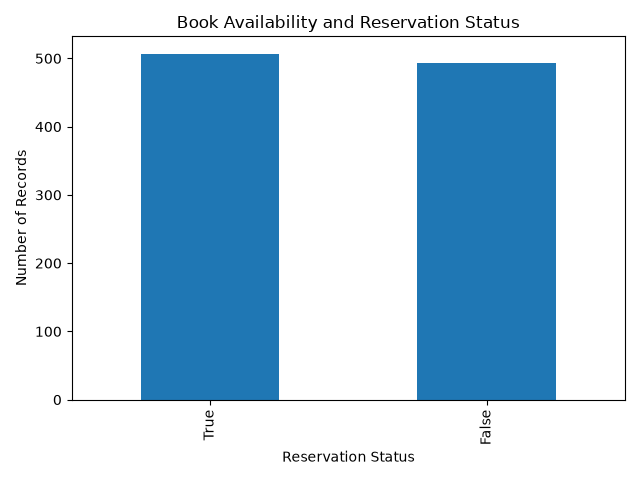

# Library-management-book-availability-system
The system solves the problem by providing quick and clear information about book availability
📊 Library Data Visualizations

### Book Availability

Popular Books

"Popular Books" (./reports/popular_books.png)

Book Category Distribution

"Book Category Distribution" (./reports/book_category.png)

Borrowing Duration

"Borrowing Duration" (./reports/borrowing_duration.png)

Reservation Status

"Reservation Status" (./reports/reservation_status.png)
