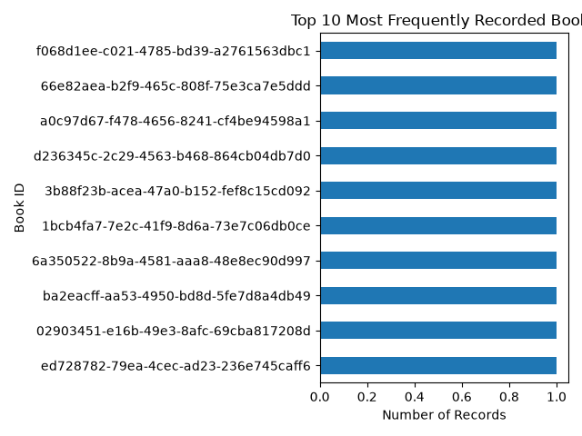
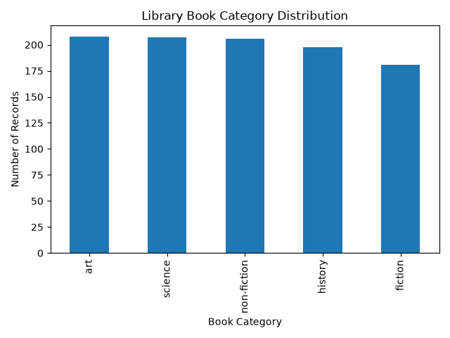
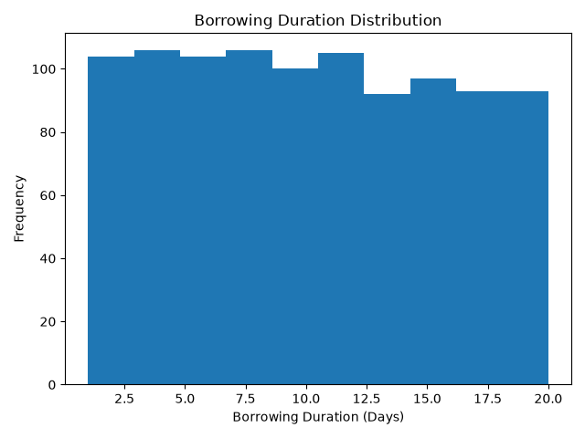
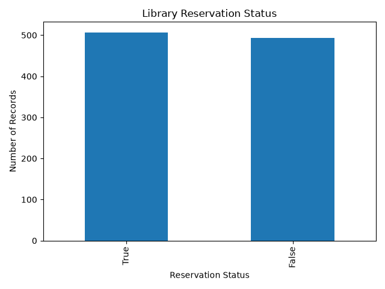

# Library-management-book-availability-system
The system solves the problem by providing quick and clear information about book availability
📊 Library Data Visualizations

### Book Availability

### popular books

###Book category distribution

###Borrowing duration

###Reservation status

