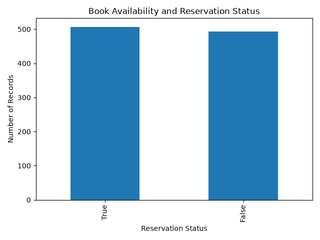
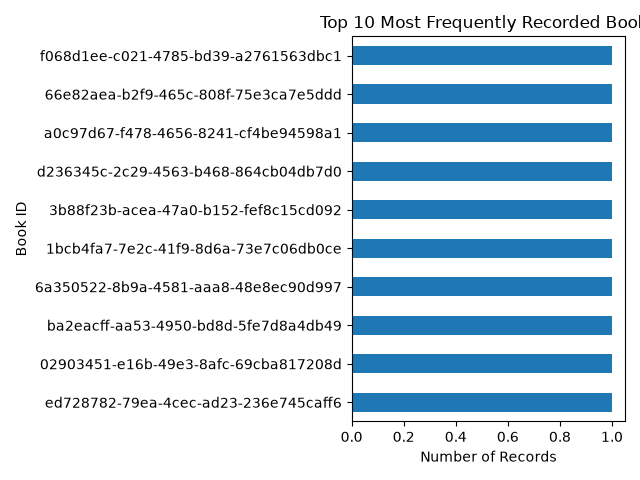
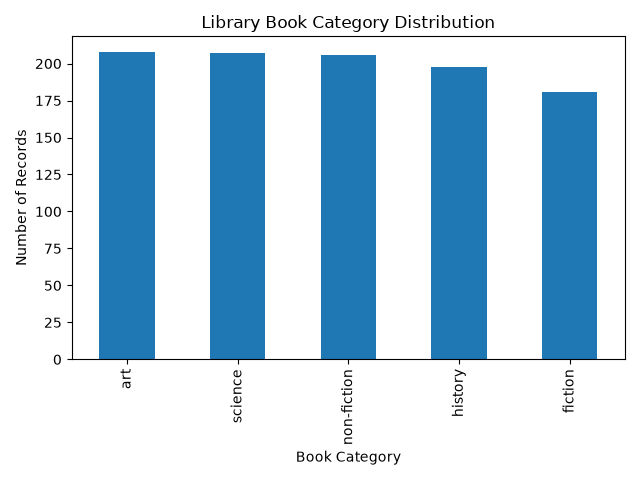
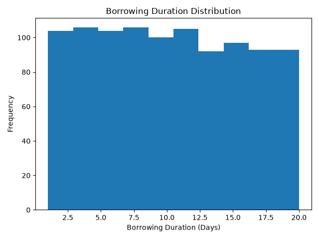
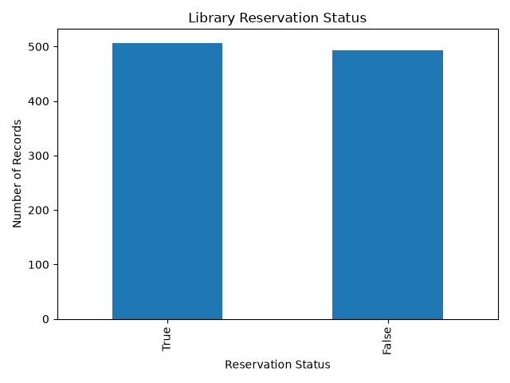

# Library-management-book-availability-system

The system provides information about book availability using the library inventory and loan records.

## Dataset workflow

The source CSV is preserved at `data/raw/library_datasets.csv`. From the project root, install the packages in `requirements.txt`, then run:

```bash
python data_cleaning.py
python Data_analysis.py
python Data_visualisation.py
```

The cleaning script writes `data/processed/library_datasets_cleaned.csv`. Analysis results and generated charts are saved under `reports/`.

## Interactive dashboard

The main integrated Streamlit application is `dashboard/app.py`. It includes five sections: Overview, Live Inventory, Catalogue, Borrow & Return, and Analytics. It reads the SQLite inventory and loan records from the root `library.db`; historical analytics use the cleaned CSV.

To run it from the project root:

```bash
pip install -r requirements.txt
streamlit run dashboard/app.py
```

The supporting dashboard modules are in `dashboard/`, database helpers are in `database/`, and the optional FastAPI backend is in `webapp/backened/`. The repository includes the Power BI report `Dashboard.pbix` as a separate analytics view. It is distinct from the integrated Streamlit application.

For a new local setup without the supplied database, initialize and seed a sample database with:

```bash
python database/db.py
python database/seed_books.py
```

The existing `library.db` is included in the project package, so do not run the sample seeder over it unless you intend to add the sample rows.

## Project documentation

- `PROJECT_PROPOSAL.md` — project proposal
- `reports/01_data_collection.md` — dataset source and collection notes
- `reports/02_data_cleaning.md` — data cleaning notes
- `MISSING_ITEMS_CHECKLIST.txt` — final classroom checklist

## Submission deliverables

- `deliverables/Library_Availability_Presentation_Final.pptx` — final presentation.
- `deliverables/Library_Management_Book_Availability_Project_Report.pdf` — print-ready report.
- `deliverables/Library_Management_Book_Availability_Project_Report.docx` — editable report.
- `dashboard/screenshots/` — overview and detail screenshots of the integrated dashboard.
- `Library_Project_Attachments.zip` — source data, cleaned data, scripts, dashboard, database, API, PBIX, screenshots and submission files.

The raw CSV is at `data/raw/library_datasets.csv`; the cleaned CSV is at `data/processed/library_datasets_cleaned.csv`.

## Existing visualizations
📊 Library Data Visualizations

### Book Availability


### popular books


###Book category distribution


###Borrowing duration


###Reservation status

